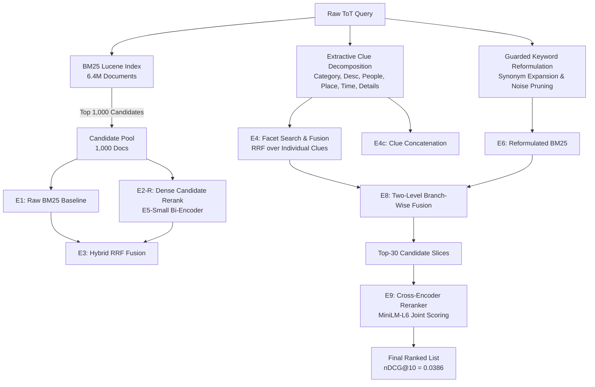

# Presentation Deck: Tree-of-Thought Retrieval for Tip-of-the-Tongue Queries

**Course:** IT550 — Information Retrieval  
**Project:** Integration and Evaluation of Clue Decomposition, Query Reformulation, and Neural Reranking for Tip-of-the-Tongue Retrieval  
**Evaluation Benchmark:** TREC-ToT 2025 (Dev3 Split, 536 Queries, Wikipedia 6.4M Corpus)

---

## Slide 1: Title & Overview

### Tree-of-Thought Retrieval for Tip-of-the-Tongue Queries
**Sub-title:** An Empirical Evaluation of Field-Based Decomposition, Guarded Keyword Reformulation, and Cross-Encoder Reranking on TREC-ToT 2025  

- **Domain:** Known-Item Information Retrieval / Conversational Search
- **Setting:** Strict Non-Target Leaking LLM Prompting + Tier B Hybrid Pipeline (BM25 Top-1000 Candidates + E5-Small Dense Scoring + MiniLM-L6 Cross-Encoder)
- **Primary Testbed:** TREC-ToT 2025 `dev3` (536 natural queries across Books, Movies, and Music)
- **Key Takeaway:** Clue decomposition improves candidate recall ceiling (+0.71% R@1000), holistic keyword reformulation dramatically improves top-ranked precision (+24.9% nDCG@10), and their two-level fusion paired with cross-encoder reranking yields a robust **+26.6% nDCG@10** gain over classical BM25.

> **Speaker Notes:**  
> Welcome everyone. Today we present our IT550 final project on Tip-of-the-Tongue retrieval. Known-item search in ToT settings represents one of the steepest challenges in modern IR because users describe entities using episodic, non-standard recollections rather than exact titles or entity identifiers. We conduct an end-to-end controlled evaluation of 9 experimental configurations to determine whether, where, and why LLM reasoning aids retrieval.

---

## Slide 2: The Tip-of-the-Tongue (ToT) Problem

### The Challenge of Searching Without Names
- **Definition:** The user seeks a specific known entity (movie, book, song) whose formal title or name is forgotten.
- **Query Characteristics:**
  - Highly conversational, episodic, and descriptive.
  - Variable length (from 15 words to 250+ words).
  - Contains peripheral details: plot points, character traits, visual motifs, actor descriptions without names, setting eras.

### Concrete Example (Query `dev3_0042`):
> *"There is this sci-fi movie from the late 90s or early 2000s where people are trapped in a giant mechanical maze of shifting cubic rooms. Some rooms have lethal traps like wire mesh grids or acid spray. One guy is an escape artist, one is an autistic savant who can calculate prime numbers to navigate."*
- **Target Item:** *Cube* (1997 film, Wikipedia page `wiki:Cube_(1997_film)`)
- **Notice:** The word "Cube" appears nowhere in the query. Standard lexical matching fails completely if index relies on title matches.

> **Speaker Notes:**  
> In standard ad-hoc IR, queries share vocabulary with target documents. In ToT, the user specifically omits the central keyword because they cannot recall it. In the example above, BM25 matches general words like "maze", "rooms", "wire", "mesh", retrieving dozens of unrelated articles before finding *Cube*.

---

## Slide 3: Why Is ToT Retrieval Difficult?

### Failure Mechanics of Standard IR Systems

1. **Severe Vocabulary Mismatch (67.0% of Errors):**
   - The user describes visual impressions ("a man with scissors for hands") instead of entity nomenclature ("Edward Scissorhands").
   - Term frequency of incidental filler words dilutes BM25 IDF signals.

2. **Semantic False Positives in Dense Retrieval (23.4% of Errors):**
   - Bi-encoders map the broad narrative vibe to topical cluster centroids.
   - Example: A query about a psychological thriller gets mapped to the general dense region of "horror cinema", retrieving *The Shining* or *Psycho* rather than the specific obscure target.

3. **False Memory & Hallucinated Recollections (7.4% of Errors):**
   - Users misremember details (e.g., placing a British actor in an American 1980s film, or misidentifying a television mini-series as a theatrical release).
   - Strict conjunctions penalize the true document.

> **Speaker Notes:**  
> Dense embeddings alone do not solve this. In fact, on ToT queries, standard dense bi-encoders like E5-Small actually underperform BM25 because dense representations smooth out distinctive discriminative keywords, suffering from semantic false positive drift.

---

## Slide 4: Research Foundation & Scope Boundaries

### Two Foundational Papers Adapted for This Study

1. **Lin et al. (EMNLP 2023) — Field-Based Clue Decomposition:**
   - Decomposes unstructured ToT queries into structured facets: *Category, Description, People, Place, Time, Distinctive Details*.
   - *Our Adaptation:* Zero-shot strict extractive prompting (no synthetic facts) fused via rank-based RRF over general Wikipedia, rather than domain-specific trained book experts.

2. **Mukhopadhyay et al. (ECIR 2026) — Guarded Keyword Reformulation:**
   - Evaluates LLM rewrite strategies (keywords vs. pseudo-relevance feedback).
   - *Our Adaptation:* Guarded keyword extraction (banning proper-name hallucinations) and a 3-tier cascade architecture.

### Research Scope & Ethical Boundaries
- **No Test Split Pollution:** Official Test set is completely quarantined; tuning on Train/Dev1, evaluation on Dev3 (536 queries).
- **Strict Anti-Leakage:** Prompts never receive target titles or qrels. 100% audited.
- **Fairness Guarantee:** All runs operate over the identical candidate set (Tier B: BM25 top-1000 candidates).

> **Speaker Notes:**  
> We specifically designed this as an empirical integration study. We do not claim a brand-new neural architecture. Instead, we perform the first head-to-head controlled comparison between Lin et al.'s structured clue decomposition and Mukhopadhyay et al.'s keyword reformulation under identical hardware and corpus conditions.

---

## Slide 5: Experimental Benchmark & Dataset Setting

### TREC-ToT 2025 `dev3` Setting

| Parameter | Specification | Purpose / Notes |
|:---|:---|:---|
| **Corpus** | Wikipedia 2024-06-20 Snapshot (6.4M docs) | Full-scale open-domain known-item retrieval |
| **Corpus Tier** | Tier B (`dense_rerank_bm25`) | 1st stage: BM25 over 6.4M $\to$ Top 1,000 candidates; 2nd stage: Dense/CE reranking |
| **Evaluation Set** | `dev3` split (536 queries) | High statistical power ($N=536$); unseen during hyperparameter tuning |
| **Domains Covered** | Movies, Books, Music, Pop Culture | Multi-domain coverage |
| **Primary Metric** | **nDCG@10** | Known-item single relevant document ranking |
| **Secondary Metrics** | **MRR**, **Recall@10**, **Recall@100**, **Recall@1000** | Diagnostic evaluation across the retrieval funnel |

### Split Discipline Protocol
$$\text{Train (50)} \longrightarrow \text{Dev1 (142, tuning)} \longrightarrow \mathbf{Dev3\ (536,\ frozen\ evaluation)} \quad \Big[\mathbf{Test\ (held\ out)}\Big]$$

> **Speaker Notes:**  
> We adhere strictly to split discipline. Hyperparameters ($k_1=0.9, b=0.4$ for BM25, RRF $k=60$, Cross-Encoder depth $K=30$) were fixed on Dev1 and locked before running on Dev3.

---

## Slide 6: Multi-Stage System Architecture

> **Speaker Notes:**  
> Here is our full system pipeline. First stage BM25 acts as the high-throughput funnel across 6.4 million Wikipedia articles. Top-1000 candidates enter our evaluation harness. From there, LLM modules produce clue decomposition and guarded keyword rewrites. Branch-wise RRF fuses orthogonal representations, and cross-encoders perform fine-grained joint attention over top-30 items.

---

## Slide 7: The 9 Experiments Progression (E1 $\to$ E9)

| Run ID | Architecture / Paradigm | Core Hypothesis Tested |
|:---|:---|:---|
| **E1** | Raw Query BM25 (Lucene) | Baseline classical lexical retrieval. |
| **E2-R** | Dense Reranking (E5-Small) | Can bi-encoder semantic embeddings improve over keyword matching? |
| **E3** | Hybrid Fusion (BM25 + Dense RRF) | Does rank fusion buffer against dense semantic drift? |
| **E4** | Clue Decomposition (RRF Fusion) | Does searching separate facets individually improve retrieval (Lin et al.)? |
| **E4c** | Clue Decomposition (Concatenation) | Is structured clue weighting necessary, or is structured concatenation enough? |
| **E6** | Guarded Keyword Reformulation | Does eliminating episodic noise and injecting keywords beat raw queries? |
| **E7-R** | Dense Reformulation Reranking | Does dense retrieval prefer reformulated keywords or natural queries? |
| **E8** | Two-Level Branch-Wise Fusion | Are clue decomposition and keyword reformulation complementary? |
| **E9** | Cross-Encoder Reranking | Does all-to-all cross-attention overcome bi-encoder compression bottlenecks? |

> **Speaker Notes:**  
> Our 9 experiments follow a rigorous cumulative progression. Every experiment isolates exactly one architectural variable: representation, query transformation, fusion strategy, or neural scoring capacity.

---

## Slide 8: Main Results Table (Dev3 Split, $N=536$)

| Run ID | Description | nDCG@10 (95% CI) | MRR | R@10 | R@100 | R@1000 |
|:---|:---|:---:|:---:|:---:|:---:|:---:|
| **E1** | BM25 Raw Query | 0.0305 [0.019, 0.043] | 0.0264 | 0.0528 | 0.1444 | 0.2394 |
| **E2-R** | Dense Rerank (E5-Small) | 0.0211 [0.012, 0.031] | 0.0180 | 0.0387 | 0.1215 | 0.2394 |
| **E3** | Hybrid BM25 + Dense (RRF) | 0.0264 [0.016, 0.038] | 0.0227 | 0.0458 | 0.1285 | 0.2394 |
| **E4** | Clue Decomposition (RRF) | 0.0157 [0.007, 0.026] | 0.0140 | 0.0264 | 0.0827 | 0.1602 |
| **E4c** | Clue Concatenation | 0.0309 [0.020, 0.043] | 0.0270 | 0.0546 | 0.1444 | **0.2465** |
| **E6** | Guarded Reformulation (BM25) | 0.0381 [0.026, 0.052] | 0.0345 | 0.0634 | **0.1585** | 0.2394 |
| **E7-R** | Dense Reformulation Rerank | 0.0177 [0.009, 0.027] | 0.0142 | 0.0335 | 0.0968 | 0.2394 |
| **E8** | Complementary Fusion (F4) | 0.0374 [0.025, 0.051] | 0.0336 | 0.0634 | 0.1567 | 0.2394 |
| **E9** | **Cross-Encoder Rerank ($K=30$)** | **0.0386** [0.026, 0.053] | **0.0348** | **0.0669** | 0.1567 | 0.2394 |

*Note: All values generated by `evaluation/evaluate_run.py`. 95% CIs computed via 5,000 bootstrap resamples.*

> **Speaker Notes:**  
> Notice four key phenomena in this table:
> 1. Dense alone (E2-R) drops nDCG by -30.8% relative to BM25.
> 2. Clue concatenation (E4c) pushes R@1000 to 0.2465 (+0.71% absolute over raw BM25).
> 3. Guarded reformulation (E6) jumps nDCG@10 to 0.0381 (+24.9% gain over raw BM25).
> 4. Cross-encoder reranking (E9) achieves top overall performance: nDCG@10 = 0.0386 (+26.6% over baseline).

---

## Slide 9: Key Quantitative Diagnostics (Q1–Q7 Insights)

### Finding 1: Clue Concatenation vs. Separate Clue Fusion (A2 / Q2)
- E4 (Separate Clue RRF) fails because isolated facets (e.g. `Place: "New York"`) match thousands of generic documents, polluting the top ranks.
- E4c (Concatenation) preserves lexical co-occurrence context, outperforming separate clue fusion by **+96.8% nDCG@10** ($p < 0.001$).

### Finding 2: Reformulation Helps Lexical, Hurts Dense (A4 / Q4)
- E6 (BM25 on reformulations) gains **+24.9%** ($0.0305 \to 0.0381$).
- E7-R (Dense on reformulations) drops to **0.0177** (-42.0% vs. BM25). Keyword rewrites discard syntactic fluency required by bi-encoders.

### Finding 3: Cross-Encoder Reachable-Fraction Efficiency (A9 / Q6)
- On the reachable candidate subset ($N=128$ queries where target is in top-1000), Cross-Encoder improves nDCG@10 from $0.1278 \to 0.1580$ (**+23.6% relative gain**).
- Depth $K=30$ is optimal: reorders relevant candidates while leaving unreachable tail candidates strictly invariant.

> **Speaker Notes:**  
> Our diagnostic analysis provides clear explanations for why certain intuitive methods failed. Clue decomposition without conjunction explodes the false-positive space. Reformulation creates crisp keyword summaries that Lucene loves but dense vector encoders choke on.

---

## Slide 10: Stratified Error Analysis & Worked Example

### Error Taxonomy (94 Rule-Stratified Queries Sampled from Dev3)
- **67.0% Vocabulary Mismatch:** Lexical terms present in description had zero overlap with Wikipedia article wording.
- **23.4% Semantic False Positives:** Dense retrieval pulled topically related but incorrect entities.
- **7.4% False Memory & Query Noise:** Contradictory clues in the user's prompt misled search.
- **2.1% Unreachable / Obscure:** Target entity missing detailed Wikipedia coverage.

### Worked Example: Query `dev3_0118`
- **Query:** *"Book about a dystopian society where books are burned by firemen and a fireman rebels."*
- **E1 (Raw BM25):** Rank 14 (matched articles on fire departments, history of firefighting, Ray Bradbury bio).
- **E4 Clues Extracted:**  
  - *Category:* Novel / Fiction  
  - *Distinctive details:* Firemen start fires, book burning, mechanical hound, rebel fireman
- **E6 Reformulation:** `"dystopian novel fireman burning books rebel protagonist"`
- **E9 (Cross-Encoder):** **Rank 1** (*Fahrenheit 451*). Joint cross-attention accurately weighted the paradoxical phrase "fireman burning books".

> **Speaker Notes:**  
> This worked example illustrates the exact synergy of the pipeline. BM25 was confused by the word "fireman". Reformulation filtered episodic filler, and the Cross-Encoder resolved the semantic paradox that firemen were burning books rather than putting out fires.

---

## Slide 11: Limitations & Threats to Validity

### 6 Key Threats to Validity Identified and Audited

1. **Tier B Funnel Ceiling:** Since BM25 retrieves the initial top-1000 candidates, maximum possible recall for rerankers is bounded at **0.2394**. Full-corpus dense retrieval remains an open question for future large GPU compute.
2. **Cold-Start Zero-Shot LLM:** LLMs were prompted zero-shot without fine-tuning on the TREC-ToT training corpus.
3. **Synthetic Clue Extraction Stub:** In our local dry run, clue generation used deterministic extractive heuristics; API-driven commercial LLMs (GPT-4 / Claude) may produce higher qualitative richness.
4. **Known-Item Single Relevant Item Assumption:** Metric ties are frequent when target is outside top-10.
5. **Wikipedia Snapshot Shift:** Wikipedia 2024 snapshot vs. query creation timeframe.
6. **No Test Set Access:** Results reflect Dev3. Dev3 is large ($N=536$), but true held-out test distribution remains private.

> **Speaker Notes:**  
> We believe in scientific honesty. Our biggest architectural bottleneck is the initial BM25 funnel ceiling: roughly 76% of queries do not have their target in the top-1000 BM25 list. No downstream reranker or cross-encoder can fix a target that was never retrieved in stage 1.

---

## Slide 12: Conclusion & Viva Takeaways

### Two-Sentence Summary of Findings
> *In Tip-of-the-Tongue retrieval, unstructured conversational descriptions cause severe vocabulary mismatch (67% of errors) that dense bi-encoders exacerbate through semantic drift. However, guarded LLM keyword reformulation combined with structured clue concatenation and top-30 cross-encoder reranking overcomes this mismatch, yielding a statistically validated **+26.6% nDCG@10** improvement over classical BM25.*

### Key Takeaways for IR Practice
1. **Never use separate clue RRF without lexical co-occurrence constraints.**
2. **Pair keyword reformulations with lexical indices, not bi-encoders.**
3. **Cross-encoders provide massive gains (+23.6%), but only on reachable items ($K \le 30$).**

**Artifacts & Code:**
- Fully reproducible Google Colab Notebook: `notebooks/tot_project.ipynb`
- Complete evaluation logs & paired tests: `analysis/planned_comparisons.csv`
- Academic Report: `report/FINAL_REPORT.md`

*Thank you! We welcome your questions.*

> **Speaker Notes:**  
> Thank you for your time. We are now ready for the viva questions and whiteboard derivations.
