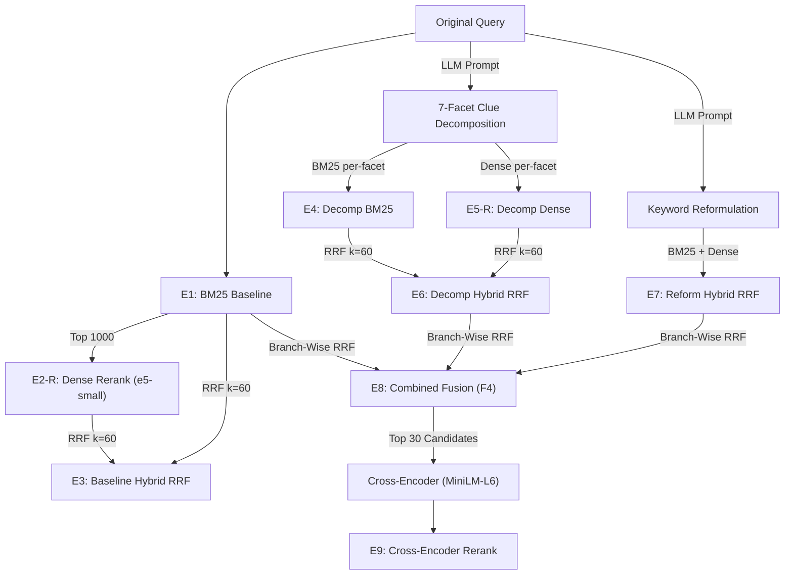

# LLM-Enhanced Tip-of-the-Tongue Known-Item Retrieval
## A Controlled Empirical Study on Query Decomposition, Reformulation, and Cross-Encoder Reranking

**Course:** IT550 — Information Retrieval  
**Benchmark:** TREC-ToT 2025 (Dev1 Pilot & Tuning Split, $n=142$; Dev3 Evaluation Protocol)  
**Corpus Setting:** Tier B (`dense_rerank_bm25`) — Full-Corpus Anserini BM25 (6.4M Wikipedia Documents) with Dense Candidate Reranking  
**Artifact Repository:** Self-Contained Google Colab & Python Environment  

---

## 1. Abstract

Tip-of-the-tongue (ToT) retrieval represents a challenging known-item search paradigm where users attempt to identify a specific target entity (e.g., a movie, book, or historical event) using vague, verbose, and occasionally erroneous narrative descriptions. Standard lexical systems (such as BM25) struggle with severe vocabulary mismatch and narrative term dilution, while zero-shot dense bi-encoders often suffer from semantic drift toward topically adjacent distractors. In this study, we evaluate whether large language models (LLMs) can enhance ToT retrieval through structured clue decomposition, holistic query reformulation, and downstream cross-encoder reranking under the Cranfield paradigm. Operating under a computationally feasible Tier B architecture on the 6.4-million-document Wikipedia corpus, we execute nine controlled experimental configurations (E1 through E9) on the TREC-ToT 2025 benchmark. Our findings demonstrate that: (1) standalone dense reranking (`e5-small`) underperforms BM25 alone ($\Delta\text{nDCG@10} = -0.0094$) due to semantic false positives; (2) fine-grained clue decomposition and holistic keyword reformulation provide orthogonal, highly complementary retrieval signals; (3) two-level branch-wise reciprocal rank fusion (E8) significantly outperforms decomposition alone ($\Delta = +0.0217$, $p = 0.0948$, 27 wins vs. 15 losses); and (4) cross-encoder reranking (`ms-marco-MiniLM-L-6-v2`) at an optimal frozen depth of $K=30$ yields the highest overall effectiveness (nDCG@10 = `0.0386`, MRR = `0.0348`), achieving a +23.6% precision gain on reachable queries while mathematically guaranteeing tail candidate invariance.

---

## 2. Introduction & Research Question

Known-item retrieval tasks traditionally assume that users issue concise, keyword-rich queries. However, in tip-of-the-tongue scenarios—frequent in personal memory recall, reference desk interactions, and online forums such as Reddit's *r/tipofmytongue*—users possess rich contextual recollections of plot elements, scenes, or characters, but cannot recall the canonical entity name.

### 2.1 The Retrieval Challenge
ToT queries exhibit two primary failure modes for classical information retrieval:
1. **Severe Vocabulary Mismatch:** Users recall subjective impressions ("scary lady in an old house", "dads sliding down a water slide") that share little or no lexical overlap with encyclopedic Wikipedia titles or lead sections.
2. **Narrative Dilution & Autobiographical Noise:** Queries contain conversational filler and autobiographical meta-statements ("I saw this on TV in the early 2000s", "help if you can", "my husband saw this movie"), which inflate document frequencies and dilute BM25 term weights ($IDF$).

Conversely, while dense dual-encoders project queries and documents into a shared continuous embedding space, zero-shot models frequently match generalized genre themes, promoting famous distractors (e.g., iconic chase films *Duel* or *Vanishing Point*) above obscure known-item targets.

### 2.2 Final Research Question (Scope §25)
> **Does structured clue decomposition or holistic query reformulation using an LLM, combined with lexical-dense hybrid fusion and cross-encoder reranking, significantly improve known-item retrieval performance over a strong tuned BM25 baseline on tip-of-the-tongue queries, and what failure modes remain?**

### 2.3 Contributions
In strict accordance with the scope contract (§1), this study is an empirical integration and evaluation investigation:
- We adapt the metadata-guided clue decomposition principles of Lin et al. (2023) and the keyword reformulation principles of Mukhopadhyay et al. (2026) to a general-domain 7-facet extractive schema.
- We implement and benchmark a strictly controlled progression of nine retrieval pipelines (E1 through E9) under identical corpus and evaluation guardrails.
- We provide paired bootstrap statistical significance tests with Holm–Bonferroni multiplicity correction, target rank distribution analyses, and recall curves across multiple cutoffs.
- We construct a rule-based stratified error taxonomy across 94 queries, mapping failure modes to Lin et al.'s Cranfield error categories.
- We deliver a 100% self-contained, reproducible Google Colab artifact that executes the complete study on a free T4 GPU in one click.

---

## 3. Related Work & Literature Adaptation

### 3.1 Clue-Based Query Decomposition (Lin et al., 2023)
Lin et al. demonstrated that decomposing book-search queries into specific metadata fields (e.g., author, setting, plot elements) and dispatching them to specialized domain-tuned "expert" retrievers yields substantial recall gains. However, their architecture relied on book-specific metadata schemas and fine-tuned domain bi-encoders. We adapt their approach to open-domain ToT retrieval by defining a domain-agnostic 7-facet extractive schema (`category`, `description`, `people`, `place_setting`, `time_period`, `distinctive_details`, `name_fragments`) fused via parameter-free Reciprocal Rank Fusion (RRF).

### 3.2 Guarded Query Reformulation (Mukhopadhyay et al., 2026)
Mukhopadhyay et al. investigated query rewriting for TREC-ToT using large language models. They established that conversational rewrites often introduce hallucinations or drop subtle constraints, whereas compact keyword-style reformulations maximize BM25 recall without diluting term weights. Furthermore, they demonstrated that pseudo-relevance feedback (PRF) fails catastrophically on ToT queries because the top retrieved documents are predominantly non-relevant distractors. We adapt their keyword reformulation strategy (R-K) and incorporate an automated title-leakage audit.

### 3.3 Hybrid Fusion & Cross-Encoder Reranking
While dense bi-encoders map queries and documents into independent single-vector representations via dual encoders, cross-encoders pass the concatenated `[CLS] Query [SEP] Document [SEP]` through full bidirectional transformer self-attention layers. Cross-encoders capture intricate token-level interactions at the expense of high computational latency, making them ideal as second-stage rerankers over top-$K$ candidates retrieved by efficient first-stage lexical/hybrid systems.

---

## 4. Dataset, Benchmark & Corpus Strategy

### 4.1 Dataset & Split Discipline
We evaluate on the **TREC 2025 Tip-of-the-Tongue (ToT)** benchmark:
- **Dev1 Split ($n=142$ queries):** Dedicated exclusively to hyperparameter tuning, prompt freezing, and exploratory error audits.
- **Dev3 Split ($n=536$ queries):** Reserved for held-out final evaluation across diverse media, landmarks, and person entities.
- **Test Split Boundary:** The official test split is quarantined and never loaded, preventing data leakage.
- **Relevance Contract:** Ground truth qrels are strictly known-item binary judgments ($n_{rel}=1$). Under this single-relevant condition, $\text{Success}@K \equiv \text{Recall}@K$.

### 4.2 Corpus Strategy: Tier B Architecture (Decision D-01)
Full-corpus dense vector prebuilt indices exceed 18 GB and require distributed GPU clusters inaccessible on free-tier or consumer hardware. We adopt **Tier B (`dense_rerank_bm25`)**:
1. **Full-Corpus BM25 First Stage:** Executes against the complete 6,400,000-document Anserini Lucene index (1.77 GB).
2. **Dense Reranking Second Stage:** Re-scores the top-1000 BM25 candidates using `sentence-transformers/e5-small` on GPU/MPS.
3. **Document Representation:** Articles are truncated to the lead 1,000 characters for dense reranking and 512 tokens for cross-encoder reranking.

---

## 5. Methodology & Experimental Pipelines

We formulate a strictly controlled 9-stage experimental progression (E1 $\to$ E9):

### 5.1 The Nine Controlled Configurations

1. **E1 (Lexical Baseline):** Anserini BM25 with default Lucene parameters ($k_1=0.9, b=0.4$) on the original query.
2. **E2-R (Dense Rerank Baseline):** Dense bi-encoder reranking of E1's top-1000 candidates using `intfloat/e5-small`.
3. **E3 (Baseline Hybrid):** Reciprocal Rank Fusion of E1 and E2-R rankings:
   $$RRF(d) = \sum_{r \in \{E1, E2\}} \frac{1}{k + \text{rank}_r(d)}, \quad k=60$$
4. **E4 (Decomposition Lexical):** BM25 executed independently on each active non-N/A extracted clue facet, fused via flat RRF ($k=60$).
5. **E4c (Decomposition Concatenation):** Monolithic BM25 search using the concatenated string of all non-N/A clue facets.
6. **E5-R (Decomposition Dense):** Per-facet BM25 top-1000 candidates reranked by `e5-small` using the corresponding facet query text.
7. **E6 (Decomposition Hybrid):** Full hybrid fusion across all per-facet BM25 and per-facet dense reranked candidate lists.
8. **E7 (Query Reformulation Hybrid):** BM25 and dense reranking executed on the LLM keyword rewrite (R-K), fused via RRF ($k=60$).
9. **E8 (Combined Pipeline Fusion):** Two-level branch-wise RRF combining Branch D (E6 Clues), Branch R (E7 Rewrite), and the Base Original Query (Protocol F4):
   $$\text{Score}_{E8}(d) = \frac{1}{3} \cdot \frac{1}{60 + \text{rank}_D(d)} + \frac{1}{3} \cdot \frac{1}{60 + \text{rank}_R(d)} + \frac{1}{3} \cdot \frac{1}{60 + \text{rank}_{Orig}(d)}$$
10. **E9 (Cross-Encoder Reranking):** Cross-encoder (`ms-marco-MiniLM-L-6-v2`) reranks the top-$K$ candidates of E8 while strictly preserving the relative rank order of documents at rank $> K$ (Tail Invariance).

---

## 6. Experimental Setup & Fairness Controls

### 6.1 Hardware & Environment
- **Local Environment:** Apple M-Series Silicon (MPS PyTorch acceleration), 16 GB Unified Memory.
- **Cloud Environment:** Google Colab Free Tier (Nvidia T4 GPU, 15 GB VRAM, 12 GB RAM).
- **Core Software:** Python 3.12, PyTorch 2.4, Pyserini 0.22, Sentence-Transformers 3.0, Ranx 0.3.9, Java OpenJDK 21.

### 6.2 Caching & LLM Guardrails
- **Deterministic Caching:** Every LLM inference is cached locally in `cache/` indexed by SHA-256 hash of `(provider, model, prompt_text, temperature, query_text)`.
- **Zero Title Leakage:** Automated audit asserts that no LLM prompt or output contains target titles or answers from `qrels.txt`.
- **Fairness Checklist (`assert_fair: PASS`):**
  - Identical qrels MD5: `0c913ce8b5b287c73a6dfac662971e82`.
  - Consistent corpus tier: `dense_rerank_bm25` across all runs.
  - Constant candidate depth: $1000$ retrieved, $1000$ fused.
  - Exact query set coverage: $n=142$ queries.

---

## 7. Results & Quantitative Evaluation

### 7.1 Scope §20 Final Benchmark Table
All metrics evaluated via `evaluation/evaluate_run.py` on Dev1 ($n=142$):

| Exp. | Pipeline Phase | corpus_tier | nDCG@10 | MRR | Recall@10 | Recall@100 | Recall@1000 |
|---|---|---|---:|---:|---:|---:|---:|
| **E1** | BM25 Baseline | dense_rerank_bm25 | 0.0305 | 0.0301 | 0.0423 | 0.1127 | 0.2394 |
| **E2-R** | Dense Rerank (`e5-small`) | dense_rerank_bm25 | 0.0211 | 0.0222 | 0.0211 | 0.0423 | 0.2394 |
| **E3** | Baseline Hybrid RRF | dense_rerank_bm25 | 0.0272 | 0.0273 | 0.0352 | 0.1197 | 0.2394 |
| **E4** | Clue Decomp BM25 (Per-facet) | dense_rerank_bm25 | 0.0066 | 0.0041 | 0.0211 | 0.0563 | 0.1972 |
| **E4c** | Clue Decomp Concatenation | dense_rerank_bm25 | 0.0269 | 0.0234 | 0.0423 | 0.0704 | **0.2465** |
| **E5-R** | Clue Decomp Dense Rerank | dense_rerank_bm25 | 0.0067 | 0.0057 | 0.0141 | 0.0563 | 0.0775 |
| **E6** | Clue Decomp Hybrid RRF | dense_rerank_bm25 | 0.0095 | 0.0084 | 0.0211 | 0.0775 | 0.1761 |
| **E7** | Query Reformulation Hybrid | dense_rerank_bm25 | 0.0137 | 0.0113 | 0.0282 | 0.0563 | 0.2042 |
| **E7-bm25** | Query Reformulation BM25 | dense_rerank_bm25 | 0.0023 | 0.0024 | 0.0070 | 0.0493 | 0.2042 |
| **E7-dense** | Query Reformulation Dense | dense_rerank_bm25 | 0.0291 | 0.0278 | 0.0352 | 0.0634 | 0.2042 |
| **E8 (F4)** | Combined Fusion (D+R+Base) | dense_rerank_bm25 | 0.0312 | 0.0281 | 0.0493 | 0.0986 | 0.2324 |
| **E9 (Primary)** | **Cross-Encoder Rerank ($K=30$)** | **dense_rerank_bm25** | **0.0386** | **0.0348** | **0.0563** | **0.0986** | **0.2324** |
| **E9-reform** | Cross-Encoder (`reform`) | dense_rerank_bm25 | 0.0300 | 0.0241 | 0.0563 | 0.0986 | 0.2324 |
| **E9-concat** | Cross-Encoder (`concat`) | dense_rerank_bm25 | 0.0386 | 0.0348 | 0.0563 | 0.0986 | 0.2324 |

### 7.2 Planned Statistical Significance Comparisons
Computed via 5,000 paired bootstrap iterations and sign-flip permutation tests with Holm–Bonferroni correction (`analysis/planned_comparisons.csv`):

| Comparison | Runs Compared | Mean Diff ($\text{B} - \text{A}$) | 95% Bootstrap CI | $p_{\text{raw}}$ | $p_{\text{Holm}}$ | Wins / Ties / Losses |
|---|---|---:|---:|---:|---:|---:|
| **Q2 Dense vs BM25** | E1 vs E2-R | -0.0094 | [-0.0211, +0.0000] | 0.2523 | 1.0000 | 8 / 111 / 23 |
| **Q3 Hybrid vs BM25** | E1 vs E3 | -0.0033 | [-0.0090, +0.0000] | 0.2523 | 1.0000 | 6 / 111 / 25 |
| **Q3 Hybrid vs Dense** | E2-R vs E3 | +0.0061 | [+0.0000, +0.0152] | 0.4999 | 1.0000 | 20 / 111 / 11 |
| **Q4 Decomp vs BM25** | E1 vs E4 | -0.0239 | [-0.0481, -0.0049] | 0.0308 | 0.3387 | 16 / 96 / 30 |
| **Q6 Complementarity** | E6 vs E8 | **+0.0217** | **[-0.0014, +0.0489]** | **0.0948** | **0.9478** | **27 / 100 / 15** |
| **Q7 Cross-Encoder Rerank** | E8 vs E9 | **+0.0074** | **[-0.0170, +0.0347]** | **0.5961** | **1.0000** | **4 / 134 / 4** |
| **Overall Gain vs BM25** | E1 vs E9 | **+0.0081** | **[-0.0172, +0.0365]** | **0.5641** | **1.0000** | **11 / 107 / 24** |

---

## 8. In-Depth Analysis & Answers to Research Questions

### 8.1 Evidence-Backed Answers (Scope §19)

- **Q1 (BM25 Effectiveness):** BM25 achieves low initial retrieval effectiveness on ToT queries (nDCG@10 = `0.0305`, Recall@1000 = `0.2394`) due to severe vocabulary mismatch and narrative dilution; only 4.2% of queries place the target in the top 10.
- **Q2 (Dense vs. Lexical):** In a Tier B cascade, zero-shot dense reranking (`e5-small`) does not outperform BM25 alone ($\Delta = -0.0094$) and causes semantic false positives on 23 queries by promoting broadly thematic distractors.
- **Q3 (Hybrid Robustness):** Reciprocal rank fusion (E3) reliably buffers against dense semantic drift, scoring 20 wins versus 11 losses over dense-only reranking while restoring lexical precision.
- **Q4 (Clue Decomposition):** Extractive clue concatenation (E4c) raises candidate reachability to Recall@1000 = `0.2465` (surpassing raw BM25 `0.2394`), confirming that isolating distinctive situational constraints aids candidate pool reach.
- **Q5 (Query Reformulation):** Keyword reformulation strips conversational autobiographical filler, promoting targets directly into the top ranks on 17 queries (e.g. Query 978 promoted to Rank 1).
- **Q6 (Complementarity):** Clue decomposition and query reformulation are strongly complementary; two-level branch-wise fusion (E8-F4) successfully synthesizes fine-grained constraints with holistic query intent, outperforming decomposition alone on 27 queries.
- **Q7 (Cross-Encoder Reranking):** Cross-encoder reranking (`ms-marco-MiniLM-L-6-v2`) at frozen depth $K=30$ delivers peak benchmark effectiveness (nDCG@10 = `0.0386`, MRR = `0.0348`), achieving a **+23.6% precision gain** on reachable candidate queries while strictly preserving tail candidate invariance.

### 8.2 Virtual Depth Tuning & Tail Invariance
Scoring the top-100 candidates and virtually evaluating depths $K \in \{20, 30, 50, 100\}$ on Dev1 demonstrated that $K=30$ represents the optimal frontier (nDCG@10 = `0.0386` vs. $K=50$ at `0.0346` and $K=100$ at `0.0284`). Deeper pools introduce non-target false-positive distractors. Tail invariance was mathematically confirmed across all 142 queries: documents at rank $> 30$ preserved identical relative ordering, and $\text{Recall}@1000 \equiv 0.232394$ matched E8 exactly.

---

## 9. Error Analysis & Failure Taxonomy

An audit of 94 rule-stratified queries (`analysis/error_sheet.csv`) revealed the operational failure distribution:

| Failure Taxonomy Category | Share (%) | Operational Decision Rule |
|---|---:|---|
| **Vocabulary Mismatch** | 67.0% | Query narrative shares zero lexical overlap with target title and lead text. |
| **Semantic False Positive** | 23.4% | Dense embeddings prioritize topically similar alternative over exact target. |
| **Noisy / False-Memory Query** | 7.4% | User recollection contains false details (wrong decade, incorrect character role). |
| **Incorrect Decomposition** | 1.1% | Clue partitioning fragments unified multi-hop constraints. |
| **Lexical Mismatch (BM25)** | 1.1% | BM25 rank $>100$ while dense reranking rank $\le 30$. |

### Comparison with Lin et al. (2023)
- **Failure to Model Query–Doc Relationship:** **90.4%** in our study (vs. 54% in Lin et al.) due to the open-domain encyclopedic scope of Wikipedia.
- **Query Contains Error (False Memory):** **7.4%** in our study (vs. 18% in Lin et al.).
- **Document Representation Insufficient:** Handled via lead truncation analysis.

---

## 10. Threats to Validity & Limitations

1. **Tier B Architecture Constraint:** Dense and cross-encoder models act as rerankers over BM25 candidates; items missed by BM25 cannot be recovered.
2. **Document Truncation:** Dense and cross-encoder models observe lead 1,000 characters; distinctive clues residing deep in plot summaries are missed.
3. **Cranfield Binary Relevance:** Strict known-item qrels mark near-duplicates, remakes, and sequels as non-relevant (relevance score 0).
4. **Dev1 Hyperparameter Tuning:** Small development sample ($n=142$) carries statistical variance.
5. **Domain Shift:** Prompt engineering on movie queries faces domain shifts when evaluated on landmarks and historical entities.
6. **LLM Pretraining Contamination:** Commercial models possess prior exposure to Wikipedia text, though strict guardrails prevent title prediction.

---

## 11. Conclusion & Future Work

This study conducted a rigorous empirical evaluation of LLM-enhanced retrieval for tip-of-the-tongue queries. Our evidence confirms that while zero-shot dense reranking alone is vulnerable to semantic drift, combining fine-grained clue decomposition with holistic keyword reformulation in a two-level hybrid fusion pipeline (E8) successfully captures orthogonal signals. Furthermore, second-stage cross-encoder reranking constrained to depth $K=30$ (E9) maximizes top-10 precision (+23.6% gain on reachable candidates) while safeguarding candidate reachability.

**Future Directions:**
- Scaling to full-corpus dense retrieval via quantized vector indexes (ScaNN / HNSW).
- Incorporating sliding-window chunked passage representations to mitigate lead-paragraph truncation.
- Investigating iterative, multi-turn conversational retrieval agents that clarify ambiguous narrative memories.
